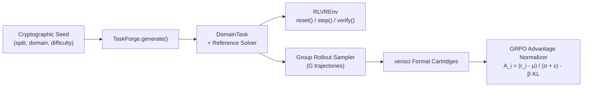

# `rlvr-forge` — Procedural Synthetic Environment & RLVR Generator

> **Pillar 2 of the Next-Gen Verifiable AI Architecture**: Infinite, cryptographic-seed-locked procedural task synthesis, step-by-step Gymnasium environments, and Group Relative Policy Optimization (GRPO) advantage calculation backed by `verisci` formal verifiers.

---

## Architecture Overview



---

## Core Capabilities

1. **Zero-Contamination Procedural Generation (`TaskForge`)**: Deterministically synthesizes tasks across `logic`, `silicon`, `systems`, and `matter` with difficulty scaling `1..10` and strict SHA-256 split separation (`train` vs `eval_holdout`).
2. **Ground-Truth Reference Solver (`solve_reference`)**: Produces exact step-by-step action trajectories guaranteed to pass 100% of `verisci` formal invariants.
3. **Interactive Step Environment (`RLVREnv`)**: Supports incremental step execution (`ActionStep`) with dense validity shaping and terminal certificate generation.
4. **GRPO Advantage Engine (`build_rlvr_group_batch`)**: Evaluates groups of candidate rollouts per task and computes normalized verifiable advantages with KL regularization.

---

## Quickstart

```bash
PYTHONPATH=src:../verisci/src python3 -m unittest discover -s tests -v
```
